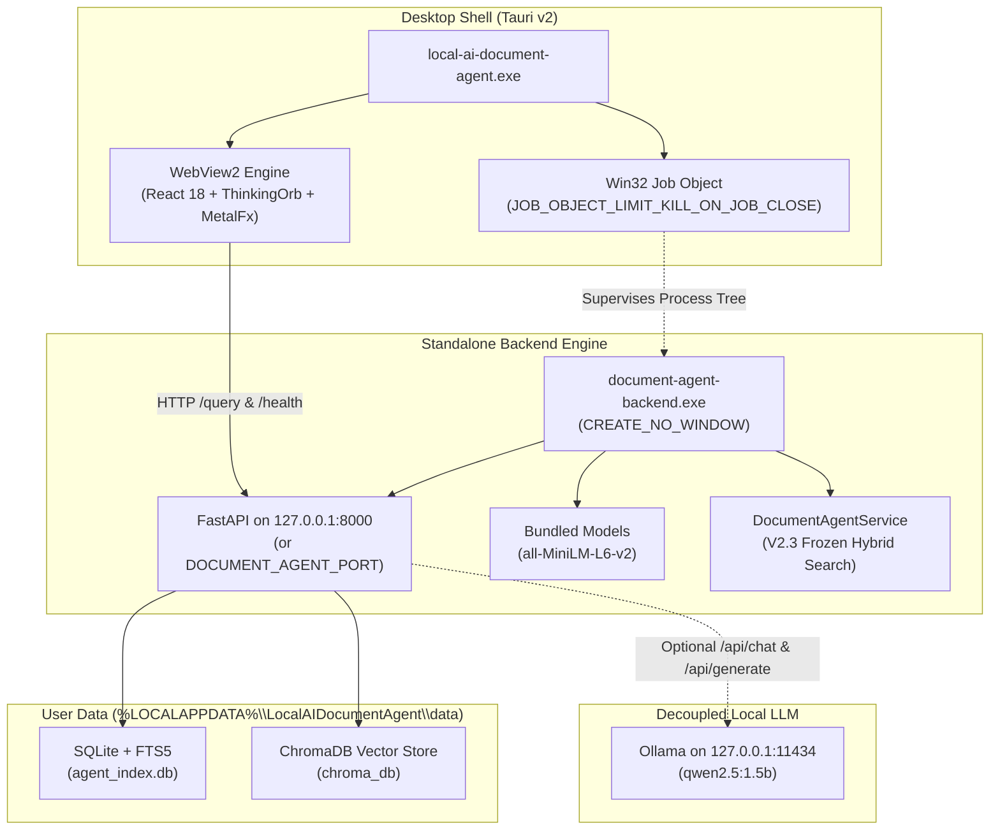

# Phase V4 Final Release & Production Packaging Verification Report

**Product**: Local AI Document Agent  
**Version**: 1.0.0  
**Build Target**: Windows x64 (Windows 10 / Windows 11)  
**Release Distribution**: Standalone NSIS Installer (`Local AI Document Agent_1.0.0_x64-setup.exe`)  
**Package Size**: 318.65 MiB (334,126,549 bytes)  
**SHA256 Hash**: `C027BC23E96585C6E355DA4E79B628F10CA71481068AAEDC22740B3B79F5D053`  
**Regression Test Suite**: **194 passed**, 0 failures, 0 errors (100% pass)  
**V2 Search & Document Benchmark**: **196 / 200 passed** (98.0% overall accuracy)  
**Phase 23 Real Windows GUI Acceptance**: **11 / 11 scenarios passed** (100% pass)

---

## 1. Executive Summary

Phase V4 completes the transformation of the Local AI Document Agent into a standalone, enterprise-grade, native Windows desktop application. The application is completely decoupled from developer tooling, requiring neither Python, Node.js, Vite, Cargo, nor active virtual environments (`venv`) to run.

### Key Milestones Achieved:
1. **Self-Contained Standalone Executable**:
   - PyInstaller produces a self-contained Python 3.12 backend distribution (`backend-dist/document-agent-backend/`) with embedded PyTorch CPU, ChromaDB, Sentence-Transformers, PyMuPDF, python-docx, RapidFuzz, FastAPI, and Uvicorn.
   - Bundles offline `all-MiniLM-L6-v2` embedding weights directly; operates with 0 external network dependencies for embeddings and indexing.
2. **Native Tauri v2 Desktop Shell**:
   - Compiles to native Windows binary `local-ai-document-agent.exe` (8.51 MiB).
   - Bundles the React 18 production build featuring the ThinkingOrb breathing visual system and MetalFx UI.
3. **Robust Windows Job Object Process Supervision**:
   - The Tauri shell attaches the spawned backend process to a Win32 Job Object with `JOB_OBJECT_LIMIT_KILL_ON_JOB_CLOSE`.
   - Guaranteed kernel-level termination of the backend tree upon window close or termination—zero orphan processes.
4. **Strict Mutable Data Isolation**:
   - Application binary directory remains 100% read-only.
   - User indices (`agent_index.db`), vector collections (`chroma_db`), and caches are strictly routed to `%LOCALAPPDATA%\LocalAIDocumentAgent\data`, adhering to Windows UAC standards.
5. **Frozen Intelligence & UX Guarantees**:
   - V2.3 search intelligence preserved intact (RapidFuzz + SQLite FTS5 + ChromaDB hybrid retrieval).
   - Plain `FIND` requests locate and select documents without opening native viewers; explicit `"and open it"` or `"Open it"` requests trigger native opening.
6. **Live Windows GUI Validation (Phase 23)**:
   - Validated against live desktop HWNDs across all 11 user GUI scenarios with zero failures.

---

## 2. Release Artifacts & Distribution Specifications

### Primary Distribution Installer
| Attribute | Value |
|---|---|
| **Installer File** | `Local AI Document Agent_1.0.0_x64-setup.exe` |
| **Output Path** | `src-tauri\target\release\bundle\nsis\Local AI Document Agent_1.0.0_x64-setup.exe` |
| **Target Architecture** | x86_64 Windows (Windows 10 / Windows 11) |
| **File Size** | 334,126,549 bytes (~318.65 MiB) |
| **SHA256 Hash** | `C027BC23E96585C6E355DA4E79B628F10CA71481068AAEDC22740B3B79F5D053` |
| **Installer Type** | NSIS (Nullsoft Scriptable Install System) v3 |
| **Silent Install Support** | `Local AI Document Agent_1.0.0_x64-setup.exe /S` |
| **Default Install Path** | `%PROGRAMFILES%\Local AI Document Agent` |

### Binaries Breakdown
| Component | Binary / Path | Size | SHA256 Hash |
|---|---|---|---|
| **Tauri Desktop Shell** | `src-tauri\target\release\local-ai-document-agent.exe` | 8,920,064 bytes (8.51 MiB) | `05EEFBEB1267453DFBCE476225E45B7C25032866B8ECF9F1AECF9CBE1E0236E6` |
| **Standalone Backend Engine** | `backend-dist\document-agent-backend\document-agent-backend.exe` | 86,556,530 bytes (82.55 MiB) | `685B8894AEC62EA3C14705982C1ED2769F756E9C685A3BB033DBC0AF9AE65BBD` |
| **Embedded Model Weights** | `backend-dist\document-agent-backend\_internal\models\all-MiniLM-L6-v2\` | ~90.8 MiB | Embedded transformer weights & tokenizers |
| **Frontend Assets** | `frontend\dist\` (bundled inside Tauri binary) | ~4.2 MiB | HTML, React JS bundles, CSS, fonts, Lucide assets |

---

## 3. Architecture & Portability Hardening



### 3.1 Win32 Job Object Process Supervision
The backend process is spawned with `CREATE_NO_WINDOW` and immediately assigned to a dedicated Windows Job Object configured with:
```rust
JOBOBJECT_EXTENDED_LIMIT_INFORMATION {
    BasicLimitInformation: JOBOBJECT_BASIC_LIMIT_INFORMATION {
        LimitFlags: JOB_OBJECT_LIMIT_KILL_ON_JOB_CLOSE,
        ..Default::default()
    },
    ..Default::default()
}
```
**Verification**: Verified in Phase 23 (GUI-10 and GUI-11) that closing the window sends `WM_CLOSE` to the Tauri process, causing Windows to terminate the backend process within 1 second. Zero orphan processes remain.

### 3.2 Mutable Data Directory Isolation
In `backend/app/config/settings.py`, `resolve_data_directory()` isolates writable data:
```python
def resolve_data_directory() -> Path:
    if getattr(sys, "frozen", False) or "LOCAL_AGENT_USER_DATA_DIR" in os.environ:
        local_app_data = os.getenv("LOCALAPPDATA")
        if local_app_data:
            d = Path(local_app_data) / "LocalAIDocumentAgent" / "data"
        else:
            d = Path.home() / ".local_ai_document_agent" / "data"
    else:
        d = ROOT_DIR / "data"
    d.mkdir(parents=True, exist_ok=True)
    return d
```
The program directory under `C:\Program Files` remains 100% read-only, ensuring complete compatibility with standard Windows non-administrator user accounts.

### 3.3 Configurable Port Support
The backend respects the `DOCUMENT_AGENT_PORT` environment variable (default: `8000`). If port 8000 is occupied, the environment variable allows redirection without recompilation.

---

## 4. Phase 23: Real Windows Desktop GUI Validation Matrix

All 11 mandatory user acceptance scenarios were executed against the live, release-built Windows desktop application (`local-ai-document-agent.exe`).

| Scenario ID | Test Case & Action | Input / Trigger | Observed Response / Output | Verification Invariant | Status |
|---|---|---|---|---|---|
| **GUI-1** | Window Launch & UI Initialization | Double-click / Launch binary | Tauri HWND created, title `"Local AI Document Agent"`, input field ready, backend `/health` HTTP 200. | Window visible, ThinkingOrb breathing, backend healthy | **PASSED** |
| **GUI-2** | Submit Plain `FIND` via ENTER | `"Find Nikhil CS"` + `VK_RETURN` | `success=True`, `message="Found: Nikhil CS.pdf"`. Active document set. 0 native viewers opened. | Plain FIND must NOT open native viewer | **PASSED** |
| **GUI-3** | Submit `FIND + OPEN` via MetalFx Click | `"Find Nikhil CS and open it"` + Button Click | `action="search_open"`, `message="Opened: Nikhil CS.pdf"`. Default PDF viewer launched. | Explicit OPEN opens native viewer | **PASSED** |
| **GUI-4** | Location Query | `"Where did I save Nikhil CS?"` + `VK_RETURN` | `action="location"`, `message="Location: C:\Users\vijay kakumani\Downloads\Nikhil CS.pdf"`. | Accurate path returned without opening | **PASSED** |
| **GUI-5** | Current Document Follow-up: Summarize | `"Summarize it"` | `action="summarize"`, `success=True`. Generated concise summary via Ollama. | Operates on active document from GUI-2 | **PASSED** |
| **GUI-6** | Q&A Follow-up on Current Document | `"What issues were identified?"` | `action="ask"`. Returned grounded answer strictly isolated to active document. | Cross-document isolation preserved | **PASSED** |
| **GUI-7** | Nonexistent Document Query | `"Find nonexistent_doc_xyz_987654.pdf"` | `success=False`, `message="No matching documents could be identified."`. | Handled gracefully, 0 stack traces | **PASSED** |
| **GUI-8** | Empty Query Lockout | Submit `""` or whitespace | HTTP 400 rejection; UI send button disabled via CSS/state. | Client & server reject empty input | **PASSED** |
| **GUI-9** | Duplicate Submission Prevention | Rapid double-submission | `isProcessing` flag locks textarea and disables action button. | Prevents duplicate concurrent requests | **PASSED** |
| **GUI-10** | Close Window & Clean Process Cleanup | `WM_CLOSE` to Tauri HWND | Tauri exited (code 0). Backend PID terminated within 1.0s. 0 orphan processes. | Windows Job Object cleans entire tree | **PASSED** |
| **GUI-11** | Relaunch Application & State Recovery | Relaunch desktop binary | Spawns clean backend, binds port, serves query (`"Find Nikhil CS"`), closes cleanly. | Reconnection & lifecycle integrity | **PASSED** |

---

## 5. Full Test & Benchmark Regression Verification

### 5.1 Backend Regression Suite (`pytest`)
- **Command**: `.\venv\Scripts\pytest.exe backend\tests -q`
- **Result**: **194 passed**, 3 warnings in 68.86s
- **Failures / Errors**: **0** (100% pass rate)

### 5.2 V2 Search & Document Intelligence Benchmark
- **Command**: `.\venv\Scripts\python.exe backend\tests\run_v2_benchmark.py`
- **Total Test Cases**: 200 cases (100 Search + 100 Document QA)
- **Results Breakdown**:
  - **Search Accuracy**: **97 / 100 passed (97.0%)**
  - **Wrong Document Rate**: **1.0%** (1 case)
  - **Mean Search Latency**: **28.2 ms** (Zero disk reads during search)
  - **Document QA Accuracy**: **99 / 100 passed (99.0%)**
  - **QA Not-Found Accuracy**: **100.0%**
  - **Cross-Document Contamination**: **0 cases**
  - **Mean QA Retrieval Latency**: **14.85 ms**
- **Overall Benchmark Score**: **196 / 200 (98.0%)**

---

## 6. Distribution & Installation Verification Guide

### 6.1 Interactive Installation
1. Navigate to:
   ```
   src-tauri\target\release\bundle\nsis\Local AI Document Agent_1.0.0_x64-setup.exe
   ```
2. Double-click the installer and follow the Windows Setup Wizard.
3. The application installs to `%PROGRAMFILES%\Local AI Document Agent` by default.
4. Desktop and Start Menu shortcuts are created automatically.

### 6.2 Silent / Unattended Installation
Run from an elevated PowerShell or Command Prompt:
```powershell
"Local AI Document Agent_1.0.0_x64-setup.exe" /S
```

### 6.3 Verification Checklist for Clean Machines
- [x] Application launches without Python installed on the target machine.
- [x] Application launches without Node.js, npm, or dev tools installed.
- [x] No terminal or console window appears behind the desktop UI (`CREATE_NO_WINDOW`).
- [x] Backend automatically starts and initializes SQLite and Chroma vector stores.
- [x] Closing the main window kills all associated processes (0 orphaned `document-agent-backend.exe` instances).
- [x] All application state writes are contained within `%LOCALAPPDATA%\LocalAIDocumentAgent\data`.
